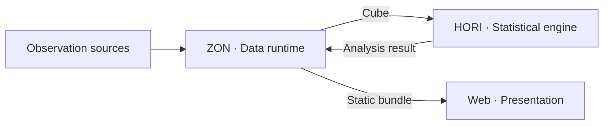

<div align="center">

# HORIZON 247

**Universal Monitoring & Entity Intelligence**

*Identify. Observe. Detect.*

### From Earth observations to evidence of change.

Built by **AETHRA** for NASA Space Apps Challenge 2026

Challenge: *Be an Earth System Trend Detective!*

[Real-data example](#a-real-data-example) · [Quick start](#quick-start) · [Architecture](#architecture) · [Scientific evidence](#evidence-and-limitations)

</div>

---

**HORIZON 247 analyzes Earth observation records to identify trends, quantify their magnitude, and explain when the available evidence is still inconclusive.**

For every location and time window, it asks three questions:

1. **Is there evidence of a trend?** Compare multiple statistical methods and account for testing many locations.
2. **How much is changing?** Report an estimated effect, uncertainty, and the quality of the underlying record.
3. **Could this record detect the change we care about?** Make sensitivity explicit, including an estimate of how much longer the observation record would need to be.

The result is a portable evidence bundle: numerical findings, quality flags, and provenance that can be inspected independently of the interface.

> **Private research preview.** The Python pipeline and real-data examples are implemented. The web application is an initial scaffold. Built for challenge evaluation; source use is governed by the current [license](LICENSE).

## Start here

| Your goal | Best starting point |
| --- | --- |
| Understand the project | Read the [real-data example](#a-real-data-example) below. |
| Try the analysis | Run the [offline quick start](#quick-start) using a committed NASA POWER cube. |
| Evaluate the science | Review the [model card](docs/MODEL_CARD.md), [method specification](packages/hori/docs/SPEC.md), and [calibration studies](sim/). |
| Build an integration | Inspect the [public Python API](packages/hori/src/hori/api.py) and [data contracts](contract/). |

## What HORIZON 247 delivers

For a variable, location, and observation window, the analysis produces:

- **Magnitude and uncertainty** — an estimated trend per decade and its interval.
- **Evidence across methods** — agreement among three trend tests and a multiple-testing adjustment across the analysis family.
- **Detectability** — the minimum detectable effect, an explicit effect-of-interest threshold, and an estimate of additional observation years when the record is inconclusive.
- **Quality context** — flags for conditions such as incomplete coverage, high autocorrelation, coarse resolution, reconstruction, and possible structural breaks.
- **Traceability** — source metadata, configuration, hashes, and build information carried with the result.

## A real-data example

The committed examples analyze **NASA POWER / MERRA-2** records over an approximate Durango bounding box: **72 grid cells, 24 years, 2001–2024**. Temperature and precipitation produce different evidence profiles under the same decision framework.

| Finding | Air temperature (`T2M`) | Precipitation (`PRECTOTCORR`) |
| --- | ---: | ---: |
| Supported trend | 66 cells | 2 cells |
| Candidate | 1 cell | 23 cells |
| Inconclusive | 5 cells | 47 cells |
| No detectable change at the chosen threshold | 0 cells | 0 cells |
| Insufficient data | 0 cells | 0 cells |

Counts come directly from the committed [temperature manifest](contract/examples/earth/power_t2m_dgo_2001-2024/manifest.json) and [precipitation manifest](contract/examples/earth/power_prectotcorr_dgo_2001-2024/manifest.json). The effect-of-interest thresholds are **0.3 °C/decade** and **0.2 (mm/day)/decade**, respectively.

For precipitation, 47 cells remain inconclusive: the record cannot yet resolve the chosen effect threshold under the model. That uncertainty is an explicit result. Cell counts describe this analysis window and bounding box; they are not a region-wide verdict or a count of independent observations.

The [input cubes and output arrays](contract/examples/) are included for inspection and regression testing. These examples use real data; synthetic calibration experiments are kept separately in [`sim/`](sim/).

## Reading a result

The verdict travels with the effect size, sensitivity, and quality flags. These five states keep a supported trend, an unresolved signal, and an inadequate record distinguishable.

<details>
<summary><strong>Verdict definitions and contract codes</strong></summary>


| State | What it means |
| --- | --- |
| **Supported trend** (`PROBADO`) | All configured voting methods are significant and the consensus survives the multiple-testing correction. |
| **Candidate** (`CANDIDATA`) | At least one method is significant, but the full decision rule is not satisfied. |
| **Inconclusive** (`NO_CONCLUYENTE`) | No method is significant, and the record is not sensitive enough to assess the chosen effect threshold. |
| **No detectable change at the chosen threshold** (`SIN_CAMBIO_MAYOR_QUE_DELTA`) | No method is significant, and modeled sensitivity reaches the chosen threshold. This is conditional on the noise model. |
| **Insufficient data** (`INSUFICIENTE`) | The record does not meet the analysis requirements. |

A trend finding describes statistical evidence under the method's assumptions. The estimated extra years describe detectability under those assumptions; they are not a forecast of future observations. See the [bundle contract](contract/SPEC.md) for exact codes, flags, and presentation rules.

</details>

## Architecture

Three independently structured components communicate through explicit data contracts.



| Component | Responsibility | Boundary |
| --- | --- | --- |
| **[ZON](packages/zon/)** | Fetch, cache, normalize, preserve provenance, orchestrate analysis, and assemble bundles. | Calls HORI through its public `hori.api` interface. |
| **[HORI](packages/hori/)** | Estimate trends, combine evidence, assess detectability, and assign verdicts. | Depends on NumPy; imports neither ZON nor the web. |
| **[Web](apps/web/)** | Present findings from static bundles. | Next.js static-export scaffold; the analytical interface is still to be built. |
| **[Contract](contract/)** | Define the cube input, bundle output, and shared TypeScript types. | Keeps data acquisition, inference, and presentation separable. |

A bundle contains a JSON manifest and typed binary arrays. Analysis runs in Python; the intended browser interface consumes the resulting files. Each Python package has its own packaging and tests. See [modularity rules](docs/MODULARITY.md).

## The method, at a glance

HORI is a **non-generative statistical engine**. Its findings come from numerical analysis, with NumPy as its only third-party runtime dependency.

1. **Prepare the record.** Aggregate monthly observations into annual series, subject to coverage and gap rules.
2. **Estimate the trend.** Compute a Sen slope and evaluate three methods: variance-corrected Mann–Kendall, trend-free prewhitening with the Wang–Swail procedure, and OLS with AR(1)-adjusted variance.
3. **Require agreement.** Form consensus evidence from the tests and apply Benjamini–Hochberg correction across the analysis family.
4. **Assess sensitivity.** Compare the minimum detectable effect with the configured effect of interest.
5. **Package the finding.** Emit verdicts, uncertainty, quality flags, and provenance together.

The code also includes parallel e-value evidence, multi-source comparison, and retrospective timeline analysis. These extensions have their own assumptions and validation status; e-value results do not replace the primary Benjamini–Hochberg verdict.

Read the [method specification](packages/hori/docs/SPEC.md) and [model card](docs/MODEL_CARD.md) for parameters, measured calibration, and limitations.

## Quick start

Run the commands below from the repository root unless a step changes directories. Python packages require **Python 3.10+**.

### 1. Set up the Python pipeline

```bash
python3 -m venv .venv
source .venv/bin/activate
python -m pip install -e ./packages/hori -e ./packages/zon
```

### 2. Analyze a real-data example offline

This uses a committed NASA POWER temperature cube. It requires no download or NASA credentials and writes a fresh bundle under `data/`.

```bash
python - <<'PY'
from hori.api import Cube, run_layer, write_bundle

cube = Cube.from_npz(
    "contract/examples/cubes/power_T2M_monthly_2001-2024.npz"
)
result = run_layer(cube, profile="auto")
output = write_bundle(result, "data/bundles/earth/durango_temperature")

print("Bundle:", output)
print("Summary:", result.manifest["summary"])
PY
```

**Expected core summary for the temperature example:** 66 supported trends, 1 candidate, and 5 inconclusive cells, out of 72 valid cells. Additional diagnostic fields may appear as the engine evolves.

The output directory contains the evidence needed to inspect the result:

```text
durango_temperature/
├── manifest.json         Source, parameters, verdict counts, and array metadata
├── effect.f32            Estimated change per decade
├── ci_lo.f32 / ci_hi.f32 Interval bounds
├── verdict.u8            Per-cell decision codes
├── flags.u8              Per-cell quality flags
├── mde.f32               Minimum detectable effect
└── …                     Further diagnostics and annual series
```

See the [bundle specification](contract/SPEC.md) for all fields, binary encoding, and cell order. The [committed reference bundles](contract/examples/) provide outputs used by regression tests.

<details>
<summary><strong>Optional: build a fresh bundle from NASA POWER</strong></summary>

### Build from NASA POWER

This optional step uses the network. The bounding-box order is **south, west, north, east**; the box below approximates Durango and is not an administrative polygon.

```bash
python -m zon build-power \
  --bbox 22.3 -107.2 26.8 -102.5 \
  --param T2M --start 2001 --end 2024 \
  --region durango --out data
```

ZON caches requests and writes cubes and bundles beneath the output directory. Add `--offline` to reuse a populated cache without network access. Run `python -m zon --help` for the current CLI.

</details>

<details>
<summary><strong>Optional: run the web scaffold</strong></summary>

### Start the web scaffold

```bash
cd apps/web
npm install
npm run dev
```

Open `http://localhost:3000`. The current page displays the project title; an interactive map and finding explorer are not implemented yet. The configured static build uses `npm run build` and writes to `out/`. See the [web guide](apps/web/README.md) for contract synchronization and frontend conventions.

</details>

## Evidence and limitations

The repository contains synthetic calibration studies, adversarial cases, package-boundary checks, and real-data regression fixtures. The [model card](docs/MODEL_CARD.md) records measured results and the conditions under which they were obtained.

The current evidence has practical limits:

- **Noise assumptions matter.** Calibration centers on Gaussian AR(1) processes. Long-memory behavior can undermine the primary trend decision; sensitivity analysis does not establish universal calibration.
- **A step can resemble a trend.** Large artificial discontinuities can trigger a finding. Structural-break flags catch only some of these cases.
- **Multiple-testing control is conditional.** The configured false discovery rate is a target under statistical assumptions, not a guaranteed error rate for every real-world field.
- **Source and scale matter.** The model card documents regional differences between POWER/MERRA-2 and GISTEMP, including an Arctic discrepancy. Native resolution and reconstruction affect interpretation.
- **Effect thresholds require judgment.** Physical-class thresholds are working choices by the team. They are not universal definitions of meaningful change.

The implemented trend method targets monotonic change. Forecasting, causal attribution, hazard alerts, and individual advice are outside its intended scope. For implementation details, start with the [current public API](packages/hori/src/hori/api.py), tests, contract, and model card.

## Development and verification

From the repository root, with the Python environment activated:

```bash
python -m pip install -e './packages/hori[dev]' -e './packages/zon[dev]'
python packages/hori/tests/test_independence.py
python -m pytest packages/hori/tests packages/zon/tests -q
```

The golden tests compare generated binary arrays against the committed real-data examples. Controlled build timestamps are supported through `SOURCE_DATE_EPOCH`; reproducible artifacts also require matching inputs, configuration, and software versions.

## Repository guide

| Path | Contents |
| --- | --- |
| [`packages/hori/`](packages/hori/) | Statistical engine, public API, method specification, and tests. |
| [`packages/zon/`](packages/zon/) | Data connectors, cache, cube handling, orchestration, and CLI. |
| [`contract/`](contract/) | [Cube specification](contract/CUBE.md), [bundle specification](contract/SPEC.md), [TypeScript types](contract/types.ts), and real-data examples. |
| [`apps/web/`](apps/web/) | Next.js application scaffold and frontend toolchain. |
| [`sim/`](sim/) | Calibration, diagnostic, and validation experiments. |
| [`docs/`](docs/) | Model card and architecture documentation. |
| [`content/`](content/) · [`design/`](design/) · [`brand/`](brand/) · [`pitch/`](pitch/) | Project narrative, design, identity, and presentation materials. |
| `data/` | Local downloads, caches, and generated artifacts; generally excluded from version control. |

## Data, attribution, and license

Real observations, analyses, reconstructions, and simulations must remain distinguishable. Findings carry their source context; simulated studies are labeled as simulations. Dataset attribution and reuse terms travel with the data and are separate from the source-code license.

HORIZON 247 is built by **team AETHRA**. See [AUTHORS](AUTHORS) for authorship and [CONTRIBUTING.md](CONTRIBUTING.md) for the team's workflow. External contributions are currently closed during the private challenge phase.

**Source code: all rights reserved under the current [LICENSE](LICENSE).** An open-source release is intended after the event; no open-source permissions are granted by that intention. See [LICENSE-DATA](LICENSE-DATA) and [NOTICE](NOTICE) for the current draft data terms and third-party credits.
