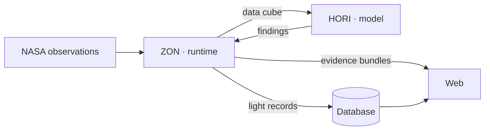

<div align="center">


# HORIZON 247

**Is the Earth really changing here — how much — and can we already know?**

Built by **AETHRA** for NASA Space Apps Challenge 2026 · *Be an Earth System Trend Detective!*

[What it does](#what-it-does) · [The three parts](#the-three-parts) · [Try it](#try-it) · [Documentation](docs/README.md) · [License](#license-and-contributing)

</div>

---

HORIZON 247 turns decades of NASA Earth observations into **evidence you can read**. For any place and any variable
it answers three questions, honestly:

1. **Is there a real change?** — or could it be chance.
2. **How big is it?** — with its range of uncertainty.
3. **If we can't tell yet, how long until we can?** — because "not enough data" is also an answer.

It never forecasts, never gives advice and never presents a simulation as an observation.

## What it does

| | |
| --- | --- |
| 🗣️ **An assistant without an LLM** | Ask in plain words («¿Cómo cambia la temperatura en Durango?»). Answers are built deterministically from the numbers — same question, same answer, every figure traceable. Three reading levels: Simple, Normal, Expert. It remembers the conversation («¿y en Chihuahua?»). |
| 🧩 **Answers that bring their own interface** | Each topic brings the components it needs: charts of the trend, latest NASA conditions, livestock heat stress, natural events, Mars dust, planets. |
| 🌍 **Monitoring** | A 3D globe or a flat map of the verdicts for the whole planet, over real NASA imagery — including **live infrared every 10 minutes** — and the **evolution of the Earth, 1981 → 2025**. |
| 🏔️ **Any place in real 3D** | Tap a zone and see it as it is: measured relief with 10 m satellite imagery. Or open a **generated scene** driven by that place's real data, with a timeline by day or by year. |
| 📣 **A swarm of people** | Signed-in people report what they see; reports stay *unverified* until the team reviews them. |
| 🎙️ **Hands-free** | Voice, camera gestures, numbered targets, keyboard and gamepad. Installable as an app (PWA), works offline with what you already saw. |

> **A real example.** Durango, Mexico, air temperature 2001–2024: in **58 of 72** zones the warming is a confirmed
> change, around **+0.5 °C per decade**. In the rest, the record is still too short to tell — and HORIZON says how many
> more years it would take.

## The three parts



| Part | What it is |
| --- | --- |
| **[HORI](docs/hori.md)** — the model | A statistical engine — *not generative AI*. It reads a time series per place and returns a verdict, the size of the change and how sure it is. It knows nothing about maps, files or the web. |
| **[ZON](docs/zon.md)** — the runtime | Fetches and prepares NASA data, runs HORI, keeps provenance for every number, and publishes the results as portable files and light database records. Also watches places over time. |
| **[Web](docs/web.md)** — the experience | The assistant, the globe, the 3D views and the swarm. A static site: it reads HORI's results as files and talks to NASA services directly. |
| **[Database](docs/database.md)** | Catalog, selected findings, monitors and people's reports. Row-level security decides what the public can see. |

### What a verdict means

| Verdict | In plain words |
| --- | --- |
| **Change detected** | There is a real change; very unlikely to be chance. |
| **Possible change** | There are signs, but not confirmed yet. |
| **Not knowable yet** | The record is too short to tell; HORIZON estimates how many more years are needed. |
| **No large change** | If there were a large change, it would most likely have been seen. |
| **Not enough data** | There is not enough observation in that place. |

## Try it

```bash
git clone https://github.com/diegoramirez772/Horizon-247.git
cd Horizon-247/apps/web
npm install
npm run dev            # http://localhost:3000
```

The repository already includes real results for the planet, Durango and Mars, so the web works right away. Optional:
copy `apps/web/.env.example` to `apps/web/.env.local` to connect the database (only the public key is ever used in the browser).

To run the Python side (model and runtime) see **[Getting started](docs/getting-started.md)**.

## Repository

| Path | |
| --- | --- |
| `packages/hori/` | HORI — the model |
| `packages/zon/` | ZON — the runtime |
| `apps/web/` | The web |
| `contract/` | The shared format between the three parts |
| `supabase/` | Database migrations and policies |
| `docs/` | Documentation |

## Data

Everything shown carries its source. NASA POWER, NASA GIBS (GOES, Himawari, MODIS, VIIRS, Blue Marble), NASA EONET,
the Mars Climate Database, Sentinel-2 cloudless (EOX) and AWS Terrain Tiles. Credits and terms in [NOTICE](NOTICE) and
[LICENSE-DATA](LICENSE-DATA). Real, estimated, simulated and example values are always labelled.

## License and contributing

**Apache License 2.0** — [LICENSE](LICENSE). Free to use, modify and redistribute, including commercially, keeping the
copyright and [NOTICE](NOTICE). The license does not grant use of the names «HORIZON 247», «HORI», «ZON» or «AETHRA».
Data keep their own terms ([LICENSE-DATA](LICENSE-DATA)).

Contributions are welcome — read [CONTRIBUTING.md](CONTRIBUTING.md) and open a pull request.

<div align="center"><sub>HORIZON 247 · AETHRA · NASA Space Apps Challenge 2026</sub></div>
