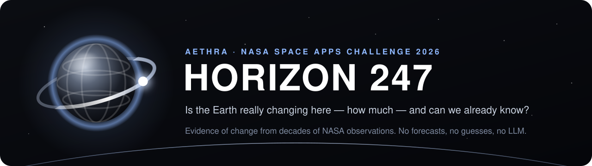
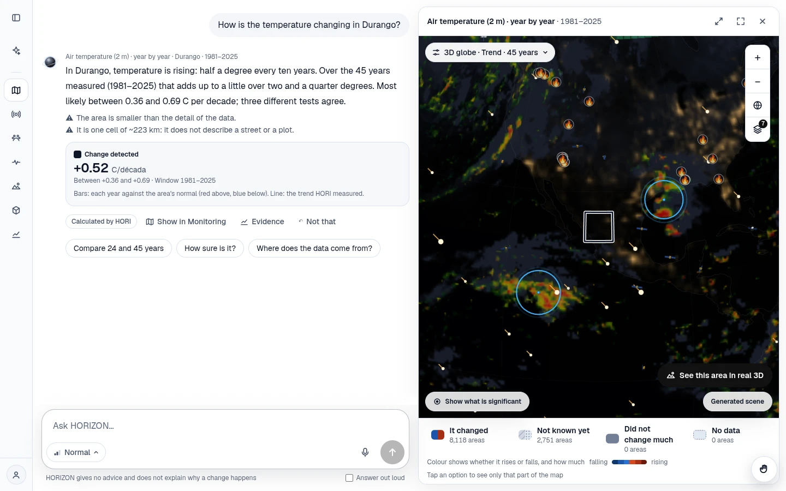
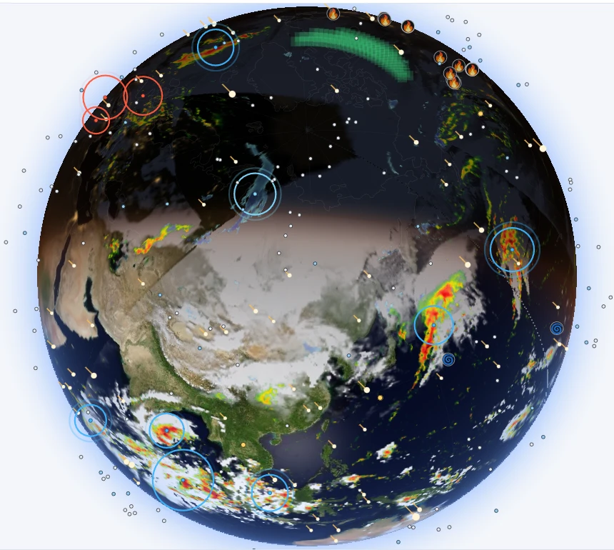
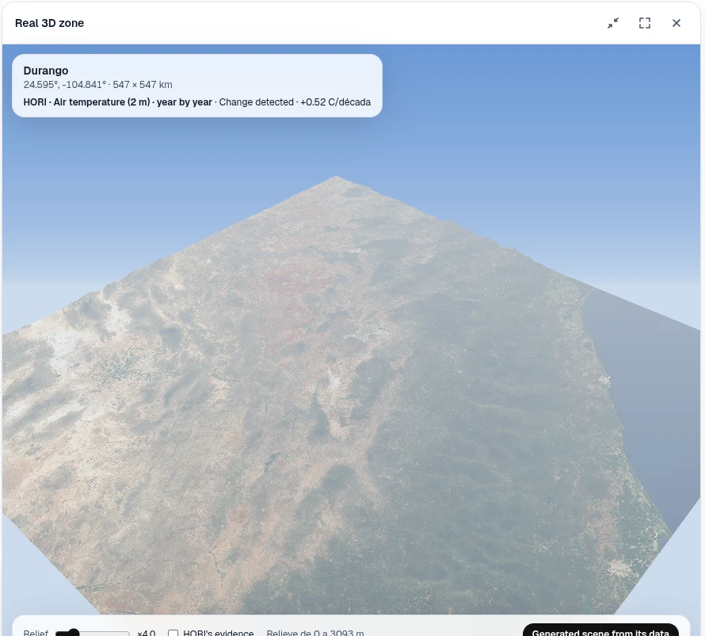
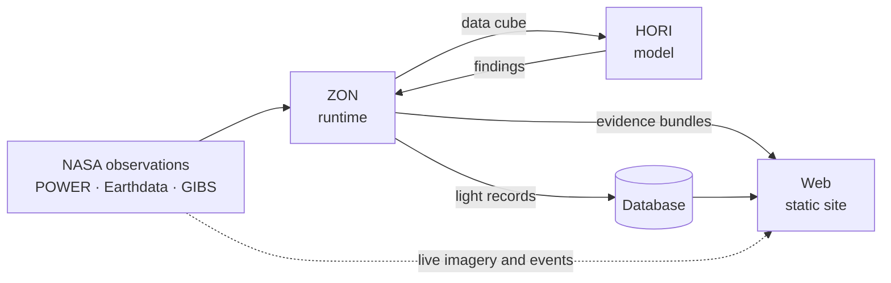

<div align="center">



<br />

[](https://github.com/diegoramirez772/Horizon-247/actions/workflows/ci.yml)
[](LICENSE)


**[What it does](#what-it-does)** · **[Real results](#real-results)** · **[How it works](#how-it-works)** · **[Checked against independent records](#checked-against-independent-records)** · **[Quick start](#quick-start)** · **[Docs](docs/README.md)**

<br />



<sub><i>«How is the temperature changing in Durango?» The answer is built from HORI's numbers, not by a language model.</i></sub>

</div>

---

HORIZON 247 turns decades of NASA Earth observations into **evidence you can read**. For any place and any variable it
answers three questions:

1. **Is there a real change?** Or could it be chance.
2. **How big is it?** With its range of uncertainty.
3. **If we can't tell yet, how long until we can?** "The record is too short" is also an answer, and it comes with a number of years.

It does not forecast, it does not give advice, and it never presents a simulation as an observation.

Built by team **AETHRA** in one weekend for the NASA Space Apps Challenge 2026, challenge
*Be an Earth System Trend Detective!*

## What it does

| | |
| --- | --- |
| **An assistant without an LLM** | Ask in plain words: «¿Cómo cambia la temperatura en Durango?». Sentences are built by rules from the numbers, so the same question always gives the same answer and every figure can be traced. Three reading levels (Simple, Normal, Expert), and it keeps the thread: «¿y en Chihuahua?». |
| **Answers that bring their own interface** | Each topic renders the components it needs: trend charts, latest NASA conditions, livestock heat stress, natural events, Mars dust, wildlife sightings. |
| **Monitoring** | A 3D globe or flat map of the verdicts for the whole planet over real NASA imagery, including live infrared every 10 minutes, and the evolution of the Earth year by year, 1981 → 2025. |
| **Any place in real 3D** | Tap a zone and see it as it is: measured relief with 10 m satellite imagery. Mexico is covered down to its 32 states and 2,478 municipalities. |
| **Several variables at once** | Where two changes coincide, for example warmer *and* less snow, HORIZON shows it and says clearly that coinciding is not causing. |
| **A swarm of people** | Signed-in people report what they see. Reports stay *unverified* until the team reviews them, and they are signals for the model, never proof. |
| **Hands-free and offline** | Voice, camera gestures, keyboard and gamepad. Installable as an app (PWA). Without a connection it shows the last good data, with its time. |

<table>
  <tr>
    <td width="50%"></td>
    <td width="50%"></td>
  </tr>
  <tr>
    <td><sub><b>Monitoring.</b> The planet over NASA imagery with live storms, fires and satellites, and the areas where HORI has found the most change.</sub></td>
    <td><sub><b>Real 3D.</b> Durango as it is: measured relief with 10 m imagery, and HORI's verdict for the zone on top.</sub></td>
  </tr>
</table>

## Real results

These numbers come from the evidence bundles shipped in this repository
([`apps/web/public/bundles`](apps/web/public/bundles)). Each one records its source, parameters and a fingerprint of its inputs.

| Layer | Places analysed | Change detected | What else it says |
| --- | ---: | ---: | --- |
| **Air temperature**, planet, 1981–2026 · NASA POWER (MERRA-2) | 207,936 | **64.6 %** | In 12.4 % the record is still too short. Half of those need about 12 more years. |
| **Rainfall**, planet, 1981–2025 · NASA POWER (MERRA-2) | 207,936 | **15.3 %** | In 47.8 % a large change would already have been seen, and it was not. |
| **Air temperature**, Durango, Mexico, 2001–2024 | 72 | **58 of 72** | Around +0.5 °C per decade. In the rest, HORIZON says how many more years it would take. |
| **Dust on Mars**, Mars years 24–36 · Mars Climate Database | 7,200 | **0** | 173 possible changes, none confirmed. Thirteen Mars years are not enough, and HORIZON says so. |

Also included: vegetation (MODIS NDVI), sea ice (NSIDC), snow cover and aerosols (MERRA-2), and three joint-change layers.

### What a verdict means

| Verdict | In plain words |
| --- | --- |
| **Change detected** | There is a real change, very unlikely to be chance. |
| **Possible change** | There are signs, but it is not confirmed yet. |
| **Not knowable yet** | The record is too short to tell. HORIZON estimates how many more years are needed. |
| **No large change** | If there were a large change, it would most likely have been seen. |
| **Not enough data** | There is not enough observation in that place. |

## How it works



| Part | What it is |
| --- | --- |
| **[HORI](docs/hori.md)**, the model | A statistical engine, *not generative AI*. It reads a time series per place and returns a verdict, the size of the change and how sure it is. It depends on NumPy only and knows nothing about maps, files or the web. |
| **[ZON](docs/zon.md)**, the runtime | Fetches and prepares NASA data, runs HORI, keeps the provenance of every number and publishes the results as portable files and light database records. It also watches places over time. |
| **[Web](docs/web.md)**, the experience | The assistant, the globe, the 3D views and the swarm. A static site that reads HORI's results as files and talks to NASA services directly from the browser. |
| **[Database](docs/database.md)** | Catalog, selected findings, monitors and people's reports. Row-level security decides what the public can see. The web works without it. |

### How HORI decides

A plain regression on a map of 200,000 places marks thousands of them by chance alone. HORI calls a change
"detected" only when all of this holds:

- **Three different trend tests agree** (Mann–Kendall with variance correction, trend-free pre-whitening, and regression with autocorrelated noise), so no single method's weakness decides the result.
- **The claim survives a false-discovery check over the whole map**, because thousands of places are tested at once.
- **A second, independent check agrees** (e-BH, built on e-values), whose guarantee holds however neighbouring places and tests depend on each other. On the planet's own noise it cut the share of false "detected" from 5.6 % to 1.0 %, and from 23.1 % to 6.9 % when slow natural wander is kept (since [HORI 1.2](docs/hori.md)).
- **The record could have shown it.** For every place HORI computes the smallest change that record can reveal. That is what separates "no large change" from "not knowable yet".

The same input always gives the same output. Error rates were measured on simulated data before the method was
trusted on real data. The studies are in [`sim/`](sim/README.md).

## Checked against independent records

| Check | Result |
| --- | --- |
| **Temperature vs NASA GISTEMP v4**, a separate record built from weather stations and ships. 5,329 land cells, 1981–2025. | Of the places where HORI detects a change with NASA POWER, **94.8 %** are also detected with GISTEMP. Only 13 cells show a confirmed change in opposite directions. Global land warming: +0.25 °C per decade (POWER) and +0.33 °C per decade (GISTEMP), both confirmed. |
| **Sea-ice extent vs the NSIDC Sea Ice Index**, 12 months × 2 hemispheres. | Correlation of **0.97 or higher** in all 24 series. |

The check also shows a limit, and it is reported as it is: GISTEMP confirms change in more places than POWER does
(only 66 % of GISTEMP's detections are also detected with POWER), and in the short 2001–2025 window the two records
agree much less. Scripts and full results are in [`sim/`](sim/).

## Quick start

**The web** (Node 22):

```bash
git clone https://github.com/diegoramirez772/Horizon-247.git
cd Horizon-247/apps/web
npm install
npm run dev            # http://localhost:3000
```

Real results for the planet, Durango and Mars are already included, so the web works right away. To connect the
database, copy `apps/web/.env.example` to `apps/web/.env.local`. Only the publishable key is ever used in the browser.

**The model and the runtime** (Python 3.10+):

```bash
python -m venv .venv && source .venv/bin/activate
python -m pip install -e './packages/hori[dev]' -e './packages/zon[dev]'
python -m pytest packages/hori/tests packages/zon/tests -q
```

**Analyse your own region** with NASA POWER (no account needed) and open it in the web:

```bash
python -m zon build-power --bbox 22.5 -107 26.5 -102.5 --param T2M --start 2001 --end 2024 --region durango --out data
python -m zon export-web --src data/bundles --out apps/web/public/bundles
```

More in **[Getting started](docs/getting-started.md)**.

## Repository

| Path | |
| --- | --- |
| [`packages/hori/`](packages/hori) | HORI, the model (Python, NumPy only) |
| [`packages/zon/`](packages/zon) | ZON, the runtime: connectors, builds, monitors, API |
| [`apps/web/`](apps/web) | The web (Next.js 16, React 19, TypeScript, Tailwind 4) |
| [`contract/`](contract) | The shared format between the three parts. It only changes additively. |
| [`sim/`](sim) | Calibration and validation studies behind the method |
| [`supabase/`](supabase) | Database migrations and policies |
| [`docs/`](docs/README.md) | Documentation |

HORI never imports ZON or the web, and a test enforces it. Any part can be taken out on its own:
see [Modularity](docs/MODULARITY.md).

## Data

Everything shown carries its source. Real, estimated, simulated and example values are always labelled.

| | Sources |
| --- | --- |
| **Analysed by HORI** | NASA POWER (MERRA-2) · NASA GISTEMP v4 · MODIS NDVI (MOD13C2) · NSIDC sea ice · MERRA-2 aerosols and snow cover · GPM IMERG · Mars Climate Database |
| **Imagery and terrain** | NASA GIBS (GOES, Himawari, MODIS, VIIRS, Blue Marble) · Sentinel-2 cloudless (EOX) · AWS Terrain Tiles |
| **Live context** | NASA EONET · NASA/JPL CNEOS · NOAA SWPC · CelesTrak · iNaturalist |
| **Places** | INEGI (Mexico's states and municipalities) · Natural Earth · OpenStreetMap |

Full credits and terms: [NOTICE](NOTICE) and [LICENSE-DATA](LICENSE-DATA).

## Principles

- **Evidence, not opinions.** Every number comes from HORI or from a named service.
- **Honest uncertainty.** "Not knowable yet" is a valid answer.
- **Labels never lie.** Nothing generated is presented as observed.
- **No advice, no alarms, no forecasts.**
- **Light and open.** It runs on a modest laptop and as a static website.

## Team

**AETHRA** · NASA Space Apps Challenge 2026, Durango, Mexico.

| | |
| --- | --- |
| **Diego** | HORI (model), ZON (runtime), integration |
| **William** | Web |
| **Estela** | Design, brand, business |
| **Carolina** | Context, business, content |

How AI tools were and were not used to build this project: **[Use of AI](docs/AI_DISCLOSURE.md)**.

## License and contributing

Code is under the **[Apache License 2.0](LICENSE)**: free to use, modify and redistribute, including commercially,
keeping the copyright and [NOTICE](NOTICE). The license does not grant use of the names «HORIZON 247», «HORI», «ZON»
or «AETHRA». Data keep their own terms ([LICENSE-DATA](LICENSE-DATA)).

Contributions are welcome. Read [CONTRIBUTING.md](CONTRIBUTING.md) and open a pull request. Disagreements with
evidence are the most valuable issues.

<div align="center"><sub>HORIZON 247 · AETHRA · NASA Space Apps Challenge 2026</sub></div>
